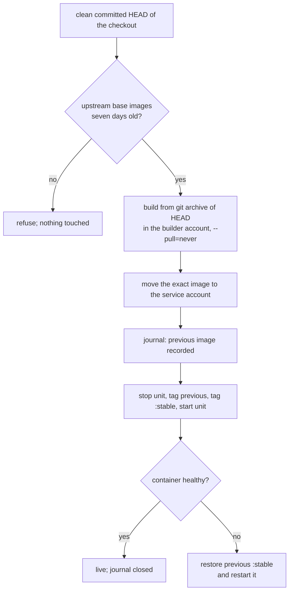

# Self-built images (server only)

Most services run an upstream image, pinned by digest from the
[image feed](updating.md#container-images). A **self-built** service runs
an image the server builds itself from a local git checkout, so changes to
that checkout — a fork, your own application — reach production without
waiting on anyone's registry.

Two services use this today:

| Service | Command | What its release does beyond the image |
|---|---|---|
| SilverBullet | `homelab-image-build` | nothing: it is stateless apart from its notes |
| Tree | `tree-dev` | checkpoints and migrates application data, and can restore it |

Both share one build pipeline (`services/tools/image_build.py`). Tree adds
its data handling on top; every other service uses `homelab-image-build`
unchanged.

## The two image paths

| | Registry image | Self-built image |
|---|---|---|
| Source | upstream registry | a git checkout on the server |
| Reference in the container file | `@image:NAME@`, rendered to `repo@sha256:…` | `localhost/NAME:stable` |
| Chosen by | the image feed commit | the committed `HEAD` of the checkout |
| Changes via | `profile update-images`, then a switch | `homelab-image-build deploy NAME` |
| Needs a system switch for a release | yes | no |

A self-built image never enters the image feed: the feed holds only
immutable registry digests.

## How a release works



- **Only committed code is built.** The build context is `git archive` of
  `HEAD`; uncommitted files cannot enter an image, and a dirty checkout is
  refused. Commit first.
- **Base images are quarantined.** Every upstream `FROM` image must have
  been observed for seven days before a build may use it, exactly as for
  Tree. Your own code is never delayed. A daily timer observes the bases of
  every declared checkout, so the clock starts without anyone asking; you can
  also start it at once with `stage`.
- **Accounts.** The root-run command dispatches into three separate
  accounts: `image-updates` authorizes and fetches the base images,
  `image-builds` runs `podman build`, and the service's own account receives
  the finished image and runs it. No account sees another's registry
  credentials or container store.
- **Transfer by ID.** The image moves between accounts by its content ID, and
  the receiving side re-checks that its provenance labels survived.

## Commands

All of them need root or the configured operator, and re-run themselves
through `sudo`. The name is the service, e.g. `silverbullet`.

```bash
homelab-image-build list                 # declared images and their mode
homelab-image-build stage NAME           # observe base images now; build nothing
homelab-image-build deploy NAME          # build (or reuse), transfer, activate
homelab-image-build rollback NAME        # swap :stable and :previous
homelab-image-build status [NAME]        # revisions, journal, unit, health
homelab-image-build recover NAME         # resolve an interrupted release
```

`deploy` prints which revision is now `:stable`. A deploy that fails its
health check restores the previous image and exits nonzero. If an
interruption (power loss, a killed command) leaves a release unsettled,
every other command for that service refuses until `homelab-image-build
recover NAME` has run; `status` shows the pending record.

`rollback` is the same guarded activation, taking the image that `deploy`
retained as `:previous`. Running it twice moves forward again. Only one
previous image is kept; older images stay in the store until removed by hand
(`podman image prune` as the owning account). Nothing is pruned
automatically.

### Build time

`deploy` allows a build up to one hour; a build that stalls longer is killed
and the release fails before anything is stopped. A from-source image that
compiles (SilverBullet's Rust server) is slow the first time: about 15
minutes on this server. A Dockerfile can avoid repeating that work with
BuildKit-style `RUN --mount=type=cache` mounts. SilverBullet's does, so a
later release that changes only the client recompiles only its own crate
(about a minute). The cache is a plain directory,
`/var/tmp/buildah-cache-<uid>` for the builder account's uid (about 1.4 GB
for SilverBullet), outside the image and outside the container store. It only
speeds builds up and never changes what an image contains. Deleting that
directory, or a `/var/tmp` cleanup, just makes the next build a cold one;
`podman image prune` and `podman builder prune` do not touch it.

## Declaring a self-built service

Which services *can* be built is fixed in `services/self-built.nix`. Whether
yours is, and where its checkout lives, is private settings:

```json
"homelab": {
  "selfBuilt": {
    "silverbullet": { "checkout": "/home/you/Developer/silverbullet", "serve": false }
  }
}
```

Edit the settings with `bash tools/profile/edit-profile.sh`, then rebuild.

`serve` decides what the service runs:

- `false` (the default): the image is built and staged as `:stable`, but the
  service keeps running its **pinned registry image**. Nothing restarts.
- `true`: the container file points at `localhost/NAME:stable`.

Why two states: the seven-day base-image quarantine means the first deploy
cannot happen on the day the checkout is declared. Keeping `serve` off lets
the service carry on unchanged until an image exists, so switching it on is a
restart into an image that is already there rather than an outage. Remove the
entry, or set `serve` back to `false`, to return to the pinned upstream image
(the pin stays in the feed for exactly this reason).

## What the Dockerfile must satisfy

The base-image gate parses the Dockerfile strictly. In the file named in
`services/self-built.nix`:

- every external `FROM` is a plain `name:tag` (or `name:tag@sha256:…`) —
  no `latest`, no `ARG` substitution, no multi-line `FROM`;
- other stages are referenced only through `COPY --from=` and
  `RUN --mount=…from=` with a stage name;
- the revision arrives as a build argument named in the catalogue
  (`revisionBuildArg`), so the built version can name its commit.

The build runs with network access for package and dependency downloads
(`npm ci`, `cargo`, `apk`); pin those with lockfiles. Only the *base images*
are age-gated.

## Adding another self-built service

1. Give the service a Dockerfile in its repository that satisfies the rules
   above.
2. Add it to `services/self-built.nix` (account, unit, container name,
   repository, Dockerfile, revision argument) and to `homelab.selfBuilt` in
   `settings/profile-schema.json`.
3. In the service module, branch on `serve` as `services/silverbullet.nix`
   does: contribute `homelab.core.selfBuilt.<name>` when serving, and
   `imageSources` otherwise. The container file keeps `Image=@image:NAME@`.
4. Give the container a `HealthCmd`; the release is judged by Podman's health
   status. Without one, the command waits for fifteen seconds of continuous
   running instead.
5. Add `NAME` to the example profile so the public example exercises the path,
   and run the tests (see [Daily use](daily-use.md#tests)).

## Files

| What | Where |
|---|---|
| Shared pipeline | `services/tools/image_build.py` |
| `homelab-image-build` | `services/tools/image-build.py`, `image-build.nix` |
| Base-image gate (`homelab-image-update inputs`, `observe-builds`) | `services/tools/dockerfile_inputs.py`, `image-update.py` |
| Which services, and how | `services/self-built.nix` |
| Release journal | `/var/lib/homelab/image-builds/NAME/` (root, `0700`) |
| Tree's version | `services/tools/tree-dev.py` |
